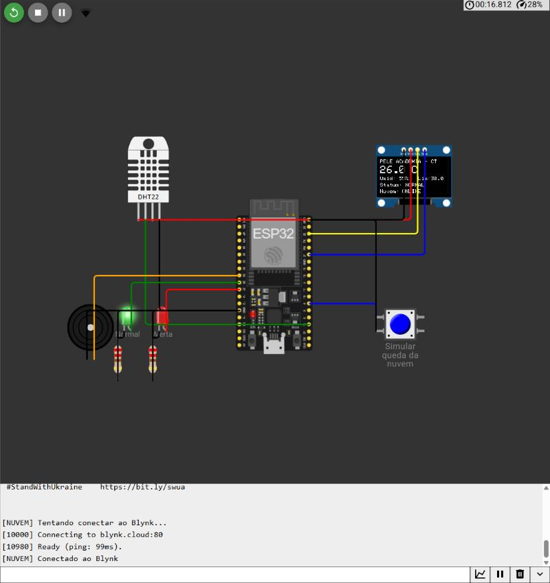
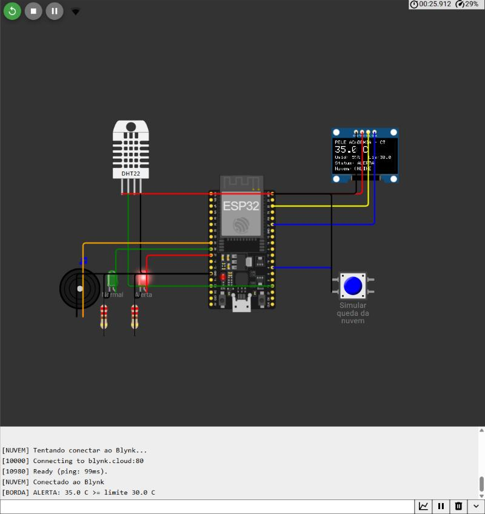
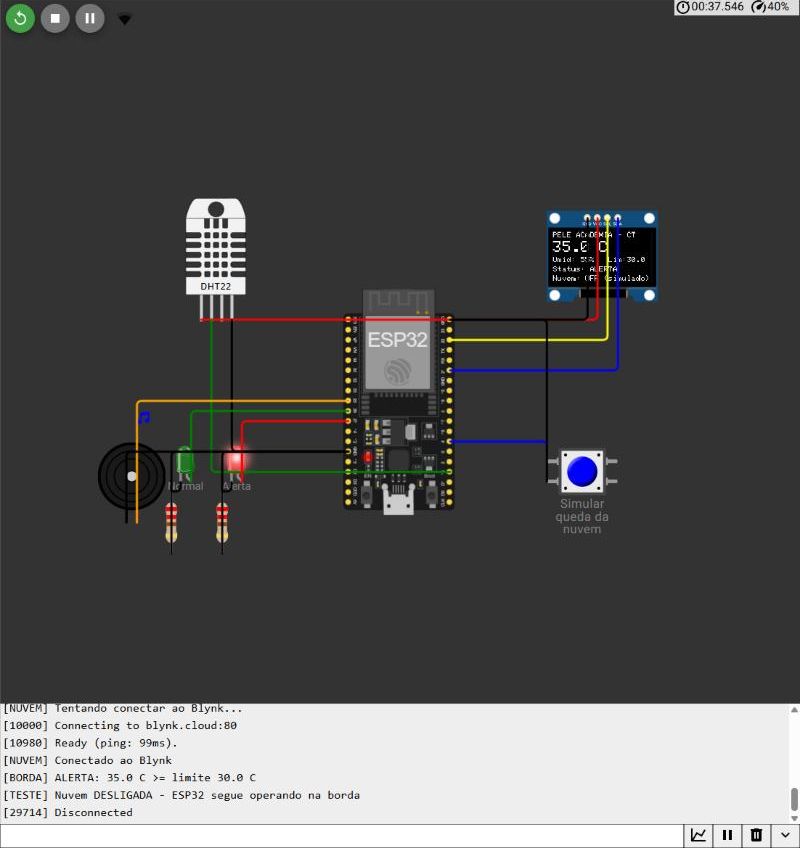
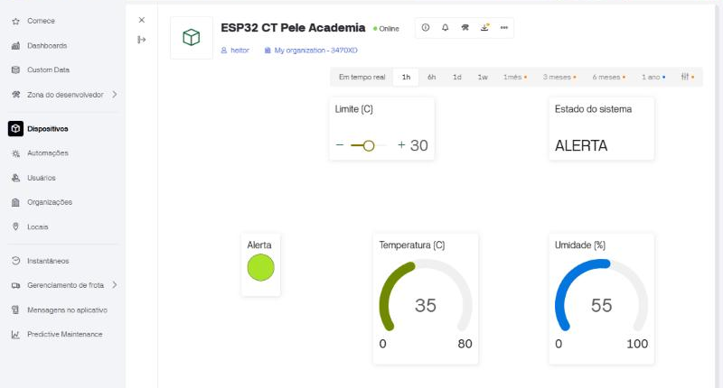

# Pelé Academia: Monitoramento de Ambiente de Treino com Edge Computing

**Sprint 4 · Edge Computing & Computer Systems · FIAP Engenharia de Software (1º ano)**

Protótipo com ESP32 que monitora a **temperatura e a umidade** de um espaço de treino da Pelé Academia. O próprio ESP32 decide se o ambiente está **Normal** ou em **Alerta** (calor excessivo para treinar), aciona LED e buzzer, mostra tudo num **display OLED** (IHM local) e envia os dados para um **painel no Blynk** (acompanhamento remoto).

Mesmo sem internet, o ESP32 continua lendo o sensor, atualizando o display e tomando a decisão. Esse é o ponto central da Edge Computing.

---

## Links da entrega

| Item | Link |
|---|---|
| Projeto no Wokwi | https://wokwi.com/projects/479326847442587649 |
| Dashboard no Blynk | https://blynk.cloud/dashboard/359197/global/devices/1091281/dashboard |

> O plano gratuito do Blynk permite apenas 1 usuário por organização, então não é possível convidar outra conta para o painel. A captura `imagens/dashboard-blynk.png` mostra o painel recebendo os dados do ESP32, e o funcionamento pode ser demonstrado ao vivo quando solicitado.

---

## Problema e solução

Treinar em ambiente muito quente aumenta o risco de desidratação e de mal-estar dos atletas. A solução coloca um sensor no espaço de treino e, quando a temperatura passa do limite (padrão **30 °C**), sinaliza o alerta no próprio local, na hora, sem depender da internet. A equipe técnica também acompanha os dados a distância pelo Blynk.

## Componentes

| Componente | Função | Pino do ESP32 |
|---|---|---|
| DHT22 | Sensor de temperatura e umidade | GPIO 15 |
| Display OLED SSD1306 (I2C) | IHM local | SDA = GPIO 21, SCL = GPIO 22 |
| LED verde + resistor 220 Ω | Indica estado **Normal** | GPIO 26 |
| LED vermelho + resistor 220 Ω | Indica estado **Alerta** | GPIO 27 |
| Buzzer | Bipe sonoro durante o alerta | GPIO 25 |
| Botão | Simula a queda da nuvem (liga/desliga Wi-Fi e Blynk) | GPIO 4 |

## Regra de decisão (executada no ESP32)

- Temperatura **≥ limite** → estado **ALERTA**: LED vermelho aceso, buzzer bipando, OLED mostra "ALERTA".
- Temperatura **< limite − 0,5 °C** → volta para **NORMAL**: LED verde aceso, buzzer desligado.
- A margem de 0,5 °C (histerese) evita que o alerta fique ligando e desligando quando a temperatura está bem no limite.
- O limite pode ser ajustado pelo slider do Blynk, mas fica **guardado no ESP32**: se a nuvem cair, o último limite continua valendo.

## O que roda na borda e o que depende da nuvem

| Operação | Onde acontece | Funciona sem internet? |
|---|---|---|
| Leitura do DHT22 a cada 2 s | **Borda (ESP32)** | ✅ Sim |
| Comparação com o limite (decisão Normal/Alerta) | **Borda (ESP32)** | ✅ Sim |
| Acionamento do LED e do buzzer | **Borda (ESP32)** | ✅ Sim |
| Atualização do display OLED (IHM local) | **Borda (ESP32)** | ✅ Sim |
| Exibição dos dados no painel remoto | **Nuvem (Blynk)** | ❌ Não |
| Histórico/gráfico das leituras | **Nuvem (Blynk)** | ❌ Não |
| Ajuste remoto do limite pelo slider | **Nuvem (Blynk)** → aplicado na borda | ❌ Não (o ESP32 mantém o último valor) |

Quando a conexão volta, o ESP32 se reconecta sozinho (tenta a cada 10 s) e o painel volta a receber os dados.

## Painel no Blynk (pinos virtuais)

| Pino virtual | Dado | Tipo | Widget sugerido |
|---|---|---|---|
| V0 | Temperatura (°C) | Double, 0 a 80 | Gauge + Chart |
| V1 | Umidade (%) | Double, 0 a 100 | Gauge |
| V2 | Estado do sistema (Normal/Alerta) | String | Label |
| V3 | Alerta (0 ou 1) | Integer, 0 a 1 | LED |
| V4 | Limite de temperatura | Double, 15 a 50 | Slider |

---

## Como executar

### 1. Configurar o Blynk

1. Crie uma conta em [blynk.cloud](https://blynk.cloud).
2. Vá em **Developer Zone → My Templates → New Template**. Nome: `Pele Academia Edge`, Hardware: **ESP32**, Connection: **WiFi**.
3. Na aba **Datastreams**, crie os 5 **Virtual Pins** da tabela acima (V0 a V4).
4. Na aba **Web Dashboard**, arraste os widgets e ligue cada um ao seu datastream. Clique em **Save**.
5. Vá em **Devices → New Device → From template**, escolha o template criado.
6. Copie as três linhas `BLYNK_TEMPLATE_ID`, `BLYNK_TEMPLATE_NAME` e `BLYNK_AUTH_TOKEN` que aparecem e cole no topo do `sketch.ino`, no lugar das que já estão lá.

### 2. Rodar no Wokwi

1. Acesse [wokwi.com](https://wokwi.com) → **New Project → ESP32**.
2. Substitua o conteúdo de `sketch.ino` e `diagram.json` pelos arquivos deste repositório.
3. Clique no **+** ao lado das abas → **New file** → `libraries.txt` e cole o conteúdo do arquivo deste repositório.
4. Clique em **▶ Start**. O Wokwi conecta na rede `Wokwi-GUEST` automaticamente.

### 3. Testar

- **Alerta:** durante a simulação, clique no DHT22 e arraste a temperatura para acima de 30 °C. O LED vermelho acende, o buzzer bipa e o OLED mostra "ALERTA". O Blynk mostra o mesmo.
- **Operação na borda sem nuvem:** aperte o **botão azul**. O OLED passa a mostrar `Nuvem: OFF (simulado)`. Mude a temperatura de novo: o alerta continua funcionando e o OLED continua atualizando, mas o Blynk para de receber dados. Aperte o botão de novo para reconectar.
- **Limite remoto:** com a nuvem ligada, mova o slider V4 no Blynk e veja o novo limite aparecer no OLED (`Lim:`).

---

## Estrutura do repositório

```
├── sketch.ino       # Código-fonte do ESP32
├── diagram.json     # Circuito do Wokwi
├── libraries.txt    # Bibliotecas usadas no Wokwi
├── README.md        # Esta documentação
└── imagens/
    ├── ihm-oled-normal.png
    ├── ihm-oled-alerta.png
    ├── ihm-oled-offline.png
    └── dashboard-blynk.png
```

## Capturas de tela

### IHM local (OLED)

| Normal | Alerta | Nuvem fora do ar |
|---|---|---|
|  |  |  |

### Painel no Blynk


